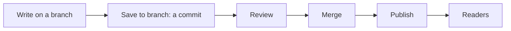

This is the part of the product that differs most from the editor-first product type, and the part
worth understanding properly.

| Page | Covers |
| :--- | :--- |
| [Branches and review](branches-and-review.md) | Where your work lives before it is published |
| [Publishing](publishing.md) | How a change reaches readers |
| [When two people edit](when-two-people-edit.md) | Conflicts, and why they are not a failure |

## The shape of it

[d360]: # 'mermaid caption="Writing, review and publishing are three separate acts."'

[d360]: # "/mermaid"

> [!IMPORTANT]
> **Saving is not publishing**
>
> In an editor-first product the two can be the same moment. Here, Save keeps a draft in Document360,
> Save to branch puts your work in the repository, and readers see nothing until it is published. Everything in this section is about the
> distance between those two events, which is deliberate — it is where review happens.

## Why a branch

Because a change that is not finished still needs saving. A branch lets you save a half-written
article without that half-written article being visible to anybody who is not looking for it.

> [!NOTE]
> **Every writer sees which branch they are on**
>
> The branch is not hidden from people who would rather not think about Git. It is shown because
> knowing where your work is, is part of knowing whether it is safe.

[d360]: # 'snippet name="deleteMe"'
