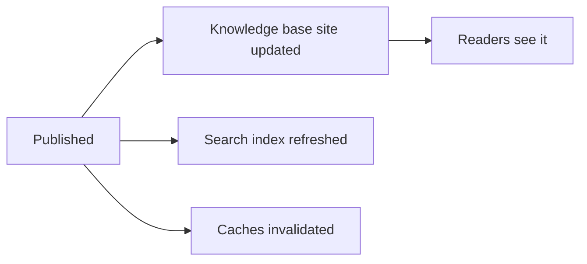

Publishing is the act that makes a change visible to readers. It is separate from saving and separate
from review, and keeping those three apart is what lets several people work on documentation at once
without readers seeing the middle of it.

Publish sits in the top bar and publishes the **whole workspace** you have open: every pending
change, made live together. It commits straight to the tracked branch, unless that branch is
protected or the publish is set to go through review; then Publish opens a pull request, and the
change goes live when that pull request is merged. It is not a per-article action, and that single fact
shapes most of what follows.

## Before you publish

- [ ] The article says something true.
- [ ] It is in the right place in the tree.
- [ ] Links to it from other articles exist, if it replaces something.
- [ ] Links *from* it resolve.
- [ ] Anything it supersedes has been updated or removed.
- [ ] The change has been reviewed by somebody who is not you.

> [!TIP]
> **The last one is the one worth protecting**
>
> Every other item on that list can be checked by tooling eventually. "Is this true, and is it what
> we meant to say?" cannot, and a review culture that survives a busy week is the thing that keeps
> documentation trustworthy.

## Publishing several changes together

Documentation changes often come in sets: a new feature's article, the changed article that refers
to it, and a navigation change that places it. Those belong together, and here they travel together
whether you planned it or not.

> [!IMPORTANT]
> **One publish, so readers never see the inconsistent middle**
>
> A new article published before the page that links to it is an article nobody can find. The page
> linking to an article that is not there yet is worse. A workspace-wide publish removes that failure
> by construction — there is no way to ship one half of a change.

The Publish dialog reviews what is about to go, grouped by kind: Articles, Snippets and
Glossary each have their own section, listed one by one; categories are counted under Others, and
variables, tags and labels appear as counts. Each row says what changed, you can
see the difference, and you can discard a single change. Anything left out is listed with its reason
— most often that the file changed in Git after your edit, which the dialog offers to take.

> [!CAUTION]
> **The other side of one publish: somebody else's unfinished edit is in your publish**
>
> Everything pending in the workspace goes. Read the dialog rather than confirming it, and keep work
> that is not ready on a working branch instead of pending on the live one.

## What publishing does not do

| Publishing | Does not |
| :--- | :--- |
| Commits your pending changes to Git, or opens a pull request | Rewrite URLs readers already have |
| Makes your change visible and updates search | Notify readers |
| Invalidates caches | Skip a review the tracked branch requires |

> [!NOTE]
> **Publishing and the repository never disagree**
>
> Publish writes the change to Git and the reader-facing site catches up with it, which is why a published change and
> the file in the repository are never two different pieces of content.

## Publishing at a chosen time

There is no scheduled publish in this product type. Publish goes out when you run it, or when its pull request is merged.

For a launch, the pattern that works is a working branch: write it there, review it there, and merge
and publish on the day. The branch is not visible to readers, which is the whole point, and a named
person with a calendar reminder does the last step.

> [!CAUTION]
> **Decide who publishes on the day, by name, before the day**
>
> This is the one step that cannot be arranged in advance, so it is the one that gets forgotten.
> "Somebody will do it at nine" is not a plan; a person who knows it is theirs is.

## After publishing

[d360]: # 'mermaid caption="What happens once a change is published."'

[d360]: # "/mermaid"

If a change is published and readers still see the old version after a few minutes, that is worth
reporting rather than republishing — republishing a change that already landed tells you nothing and
muddies the history.

Can I unpublish something?

No. There is no unpublish in this product type: to take an article off the site you delete it, in
Document360 or in Git. There is no recycle bin either, so the deletion is final in Document360 and
Git history is the recovery path — which is why nothing is actually lost.

What if I publish something wrong?

Publish the correction. In a Git-backed project the previous content is never lost, so reverting is
a normal operation rather than a recovery — and the record shows both what was said and that it was
corrected, which is more honest than a silent fix.

[d360]: # 'snippet name="deleteMe"'
