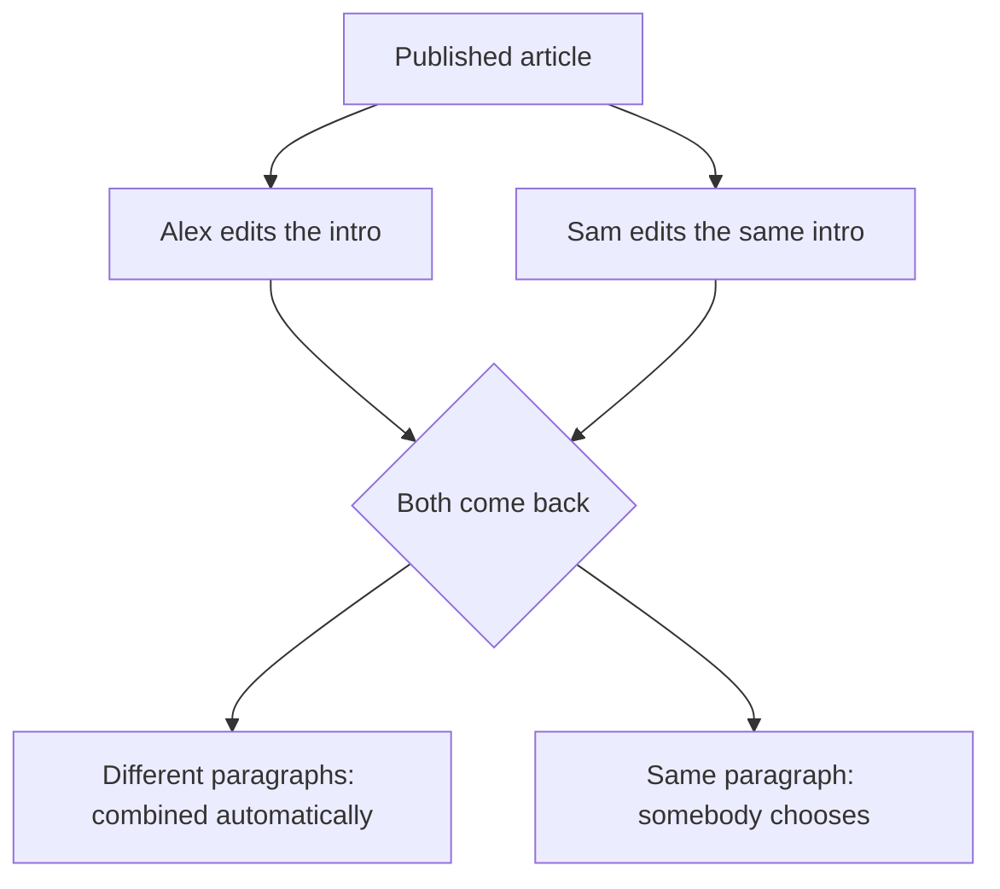

This is the one genuinely new idea the Git-backed product type asks a writer to hold, and it is
smaller than its reputation.

## Why it happens at all

Two people can work on the same article in two places at the same time, because the content is files
and files can be copied. When both sets of work come back together, something has to decide what the
article now says.

[d360]: # 'mermaid caption="The same article, two branches, two edits."'

[d360]: # "/mermaid"

[d360]: # 'callout kind="success"'

> **Most of the time nothing happens at all**
>
> Two people editing different parts of one article is combined without anybody being asked. A
> conflict only arises when two edits touch the same lines, which is rarer than it sounds.

[d360]: # "/callout"

## What you actually see

An incoming change from Git never replaces what you are typing. The Git status shows **Updates**
instead, and nothing moves until you take them.

Taking the updates saves your work first, then merges Git's change into your draft. If the two do
not overlap, that is the end of it. If they do, **Review conflicts** opens.

[d360]: # 'table border="all" striped="true"'

| In the conflict review | |
| :--- | :--- |
| For each conflicting block | Keep inbound (Git), Keep yours (Document360), or Keep both — yours first |
| Changed your mind | Revert |
| Progress | "x of y", and Mark as resolved per article |
| Prefer the raw text | A Markdown view |

[d360]: # "/table"

> [!IMPORTANT]
> **Nothing is lost while a conflict is unresolved**
>
> Both versions exist, and neither is discarded until somebody answers the question. Saving and
> publishing are unavailable until they are resolved, which is the product refusing to let you build
> on an unanswered question.

Formatting-only differences are settled for you, and the screen says so. While one person is
resolving an article it is locked for everybody else, who see "{name} is resolving conflicts".

## Three things that resolve without asking you

> [!CAUTION]
> **Front matter, snippets and deletions follow rules rather than your judgement**
>
> Front matter merges key by key; where both sides changed the same setting, Document360 keeps its
> own value, writes it on the next publish and tells you which. A snippet changed on both sides is
> not reviewed at all — Document360's version wins. And a snippet deleted in Git is deleted even if
> articles still use it.

Deleted on one side and edited on the other is the one deletion you are asked about: delete it, or
keep the article.

## Avoiding most of them

[d360]: # 'multi-level-list styles="decimal,lower-alpha"'

1. **Keep changes small and merge them quickly.** The longer a branch lives, the further the
   published content moves underneath it.
2. **Say what you are working on.** Two writers rewriting the same page on the same afternoon is a
   coordination problem that no tool fixes.
3. **Prefer adding to restructuring.** A new section rarely conflicts; a reorganised page conflicts
   with everything.
4. **Do not reflow text you have not changed.**
   1. Re-wrapping a paragraph makes every line look edited.
   2. Two people reflowing the same file conflict on every line of it, with no actual disagreement.

[d360]: # "/multi-level-list"

> [!CAUTION]
> **Automatic reformatting is the biggest single cause of avoidable conflicts**
>
> An editor that re-wraps Markdown on save turns every edit into a whole-file edit. Turn it off for
> this repository, and most conflicts stop happening.

## Live editing and branches

Several people can work in one project at once. What keeps that workable is that each piece of work
has somewhere to live — a branch — and that collisions are detected when work comes back together
rather than being silently resolved in somebody's favour.

> [!NOTE]
> **Detection at the boundary, not inside the editor**
>
> Two people typing in the same place at the same moment is a live-editing question. Two people
> having edited the same place in two branches is a conflict question. They are different problems
> and Document360 treats them differently.

What if I resolve it wrongly?

Publish a correction. The history holds both original versions and your resolution, so a wrong choice
is recoverable in a way that an overwritten database record would not be.

Can a conflict happen in the navigation?

Yes — two people reordering the tree are both editing `d360.json`. It resolves the same way: somebody
decides what the order should be. This is a good reason to make navigation changes deliberately
rather than as a side effect of something else.

Do I need to understand Git to resolve one?

No. The question you are being asked is "which of these two paragraphs should the article have?",
and that is an editorial question you are better placed to answer than any engineer.

[d360]: # 'snippet name="deleteMe"'
