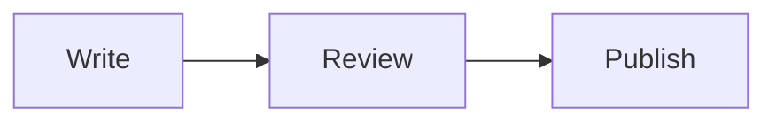

This page demonstrates each block by using it. Everything you see below is a block you can insert
from the editor's menu.

## Callouts

Eight kinds. Use them for something a reader must not miss, and sparingly — a page of callouts is a
page with no emphasis at all.

> [!NOTE]
> **Note**
>
> Context worth having, which does not change what you do.

> [!TIP]
> **Tip**
>
> A better way to do the thing you are already doing.

[d360]: # 'callout kind="info"'

> **Info**
>
> Neutral information, often about availability or scope.

[d360]: # "/callout"

[d360]: # 'callout kind="success"'

> **Success**
>
> Confirmation that something worked, or that a choice was the right one.

[d360]: # "/callout"

> [!IMPORTANT]
> **Important**
>
> Something that changes what the reader should do.

> [!WARNING]
> **Warning**
>
> Something that will go wrong if ignored.

> [!CAUTION]
> **Caution**
>
> A risk with consequences beyond the immediate task.

[d360]: # 'callout kind="error"'

> **Error**
>
> Something irreversible, or a mistake with a cost.

[d360]: # "/callout"

> [!TIP]
> **A callout's first bold paragraph becomes its title**
>
> And only when at least one more block follows it. A callout containing nothing but a bold line is
> a callout with a body and no title, which is usually what you wanted anyway.

## Collapsibles

An accordion, for detail that most readers do not need:

<details>
<summary>How accordions behave in search</summary>

Collapsed content is still indexed and still matched. A reader arriving from search sees the section
open. Hiding something in an accordion hides it from the page, not from search.

</details>

They nest, which is occasionally useful and quickly overused:

<details>
<summary>An accordion containing accordions</summary>

<details>
<summary>The first inner one</summary>

Two levels is readable.

</details>

<details>
<summary>The second inner one</summary>

Three is a sign the page needs splitting.

</details>

</details>

## Tabs

For the same instruction in several contexts — platforms, languages, roles:

[d360]: # "tabs"

<details>
<summary>First tab</summary>

Each tab is a `<details>` inside a tabs block.

</details>

<details>
<summary>Second tab</summary>

Readers see tabs; a plain Markdown renderer sees a stack of collapsibles, which still reads
correctly.

</details>

[d360]: # "/tabs"

## FAQ

For genuine questions, phrased as a reader would ask them:

[d360]: # "faq"

<details>
<summary>Is an FAQ block different from an accordion?</summary>

Structurally they are both `<details>`. The FAQ block tells Document360 that these are
question-and-answer pairs, which affects how they are presented and how they are picked up.

</details>

<details>
<summary>Should I put everything in an FAQ?</summary>

No. An FAQ is where genuinely frequent questions go. A page that is entirely FAQ is usually a page
whose structure was never decided.

</details>

[d360]: # "/faq"

## Tables

A plain Markdown table:

| Block | Use it for |
| :--- | :--- |
| Callout | Something a reader must not miss |
| Accordion | Detail most readers skip |
| Tabs | One instruction, several contexts |

Or a configured one, with borders and striping:

[d360]: # 'table border="all" striped="true"'

| Option | Effect |
| :--- | :--- |
| `border` | Which borders are drawn |
| `striped` | Alternate row shading |

[d360]: # "/table"

## Code

With line numbers, for code you will refer to by line:

```json lineNumbers
{
  "serializerVersion": 1,
  "languages": [{ "code": "en", "default": true }]
}
```

With wrapping, for lines that are long and must not be scrolled:

```text wordWrap
This single line is longer than the column it is displayed in, so wrapping is kinder than a horizontal scrollbar.
```

## Lists with their own numbering

[d360]: # 'multi-level-list styles="decimal,lower-alpha"'

1. A numbered step.
   1. A sub-step, lettered rather than numbered.
   2. Another.
2. The next step.

[d360]: # "/multi-level-list"

## Diagrams

[d360]: # 'mermaid caption="A diagram is written as text, so it diffs like text."'



[d360]: # "/mermaid"

## Mathematics

Inline, as in $E = mc^2$, and as a block:

$$
\sum_{i=1}^{n} x_i = x_1 + x_2 + \cdots + x_n
$$

## Media and attachments

A figure, with a caption:

[d360]: # 'figure align="center" width="760"'

{width="760" height="320"}

A figure is an image plus a caption, and the caption is part of the block rather than a paragraph
underneath it.

[d360]: # "/figure"

A video:

[d360]: # 'video src="https://commondatastorage.googleapis.com/gtv-videos-bucket/sample/ForBiggerFun.mp4" width="720" height="405" controls="true"'

[d360]: # "/video"

An embedded PDF:

[d360]: # 'pdf src="https://www.w3.org/WAI/ER/tests/xhtml/testfiles/resources/pdf/dummy.pdf" width="100%" height="420"'

[d360]: # "/pdf"

A file for the reader to download:

[d360]: # 'file href="https://placehold.co/sample.csv" name="sample-export.csv" type="csv" size="2048"'

[d360]: # "/file"

## Dividers and page breaks

A styled divider, for a change of subject within a page:

[d360]: # 'divider style="dashed"'

---

And a page break, which matters when the article is exported to PDF:

[d360]: # "page-break"

## Notes only your team can see

[d360]: # "private-note"

**Internal: a private note never reaches the knowledge base site**

It is visible in the editor and in the repository, and it is excluded from what readers receive. Use
it for the thing the next writer needs to know and the reader does not — ownership, a caveat, a
reason the page is written the way it is.

[d360]: # "/private-note"

> [!WARNING]
> **A private note is not a secret**
>
> It is in the repository, so anybody who can read the repository can read it. Keep credentials and
> anything genuinely confidential out of it.

[d360]: # 'snippet name="deleteMe"'
