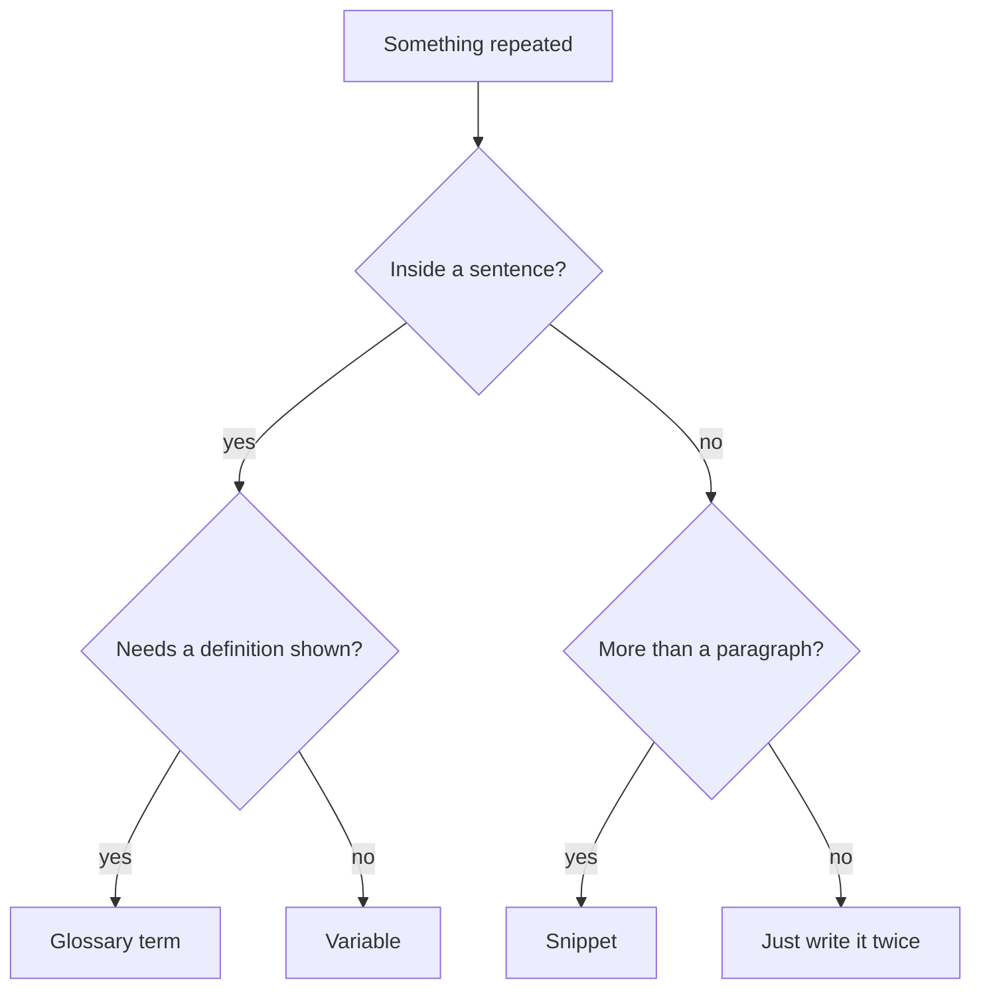

Three mechanisms, for three different sizes of thing.

[d360]: # 'table border="all" striped="true"'

| | Reuses | Stored in this project as |
| :--- | :--- | :--- |
| **Snippet** | A block, or several | `.document360/snippets/global/<name>.md` |
| **Variable** | A word or a value, inline | An entry in `.document360/variables.json` |
| **Glossary term** | A term, inline, with a definition on hover | One Markdown file per term |

[d360]: # "/table"

## Snippets

A snippet is a Markdown file holding content you use in several articles. Change the file and every
article that includes it changes.

```markdown
---
name: supportFooter
description: Where to get help, at the end of an article.
contentType: markdown
---

Content goes here, and it can contain any block.
```

Insert one from the editor, and the article gets a single line referring to it by name.

> [!IMPORTANT]
> **A snippet is a block, not a phrase**
>
> It is inserted between paragraphs, not inside one. For something that belongs inside a sentence —
> a product name, a version number — use a variable.

## Variables

A variable is a named value, substituted wherever it appears. This project ships four:

| Variable | Value |
| :--- | :--- |
| `productType` | <span data-variable="productType">{{variable.productType}}</span> |
| `siblingType` | <span data-variable="siblingType">{{variable.siblingType}}</span> |
| `editorName` | <span data-variable="editorName">{{variable.editorName}}</span> |
| `docsRoot` | <span data-variable="docsRoot">{{variable.docsRoot}}</span> |

Every one of those table cells is the variable, not a copy of its value — change
`.document360/variables.json` and this table changes with it.

> [!TIP]
> **Variables are for things that change, not for every repeated word**
>
> A product name that marketing might rename, a URL that will move, a version you will bump. Turning
> ordinary nouns into variables makes the Markdown harder to read for no benefit.

## Glossary terms

A glossary term marks a word in your text and shows its definition to the reader.

Terms are files like everything else: **one Markdown file per term** in the workspace's glossary
folder, named for the term's slug. Front matter holds the term and its aliases, the body holds the
definition, and an image in the definition is plain Markdown in that body.

> [!IMPORTANT]
> **Glossary terms sync both ways, like snippets**
>
> A term you add in Document360 is a pending change that reaches Git through Publish. A term added,
> changed or deleted in Git is imported with the sync, under the same all-or-nothing rules as any
> other content — and it can raise a conflict like any other file.

Terms belong to one workspace: they are highlighted only in that workspace's articles, and an
article can use only its own workspace's terms.

> [!CAUTION]
> **A term is only useful where the reader meets the word**
>
> Marking the same term on forty pages produces forty dotted underlines nobody hovers over. Mark it
> where somebody is genuinely likely to be new to the word, which is usually its first appearance in
> a category rather than its first appearance on a page.

## Choosing between them

[d360]: # 'mermaid caption="Work down this and you will pick the right one."'



[d360]: # "/mermaid"

> [!NOTE]
> **"Just write it twice" is a real answer**
>
> Two copies of one sentence cost nothing to maintain. Reuse earns its complexity at three or four
> uses, not at two, and a project with forty snippets is harder to edit than one with eight.

## Reuse and review

Because snippets and variables are files, a change to one is a change in a branch, reviewed like any
other. That is the advantage and also the thing to watch:

> [!CAUTION]
> **Editing a snippet changes every article that uses it**
>
> The diff shows one file. The effect is on twenty pages. When you review a snippet change, check
> where it is used before approving it — a wording that fits one article can be wrong in another.

[d360]: # 'snippet name="deleteMe"'
